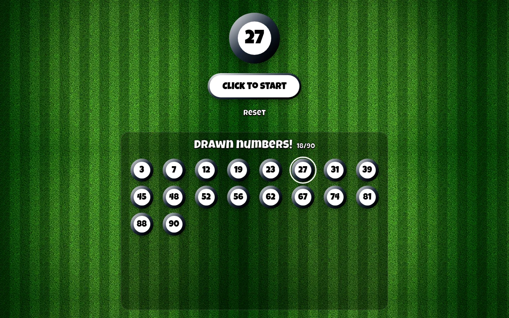
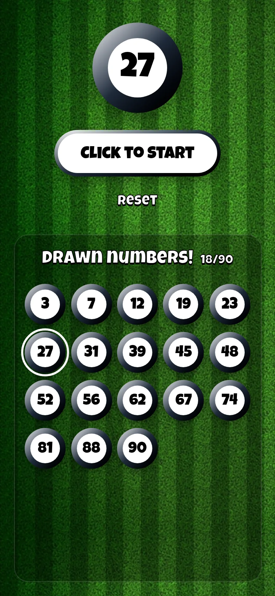

# Bingo Machine

[](https://github.com/CarlosLagos29/BingoMachine/actions/workflows/ci.yml)

A 90-ball bingo caller for the browser. Press the button, watch the balls spin while the sound plays, and the drawn number is added to the board.

<p align="center">
  
  &nbsp;
  
</p>

## Features

- **90 balls**, drawn at random without repeats.
- **Draw animation** with sound: numbers spin for 9 seconds before the ball is revealed.
- **Drawn numbers board**, sorted so players can check their cards quickly.
- **The game survives a refresh:** the state is saved in `sessionStorage`, so reloading the page keeps the drawn numbers.
- **Safe controls:** Start and Reset are disabled while a ball is being drawn, and Start shows "No more numbers" when all 90 are out.
- **Responsive**, designed to be used from a phone.

## Tech stack

| Area    | Tools                    |
| ------- | ------------------------ |
| UI      | React 19, Tailwind CSS 4 |
| Build   | Vite 8                   |
| Quality | ESLint 10                |

Plain JavaScript and no runtime dependencies besides React.

## Getting started

Requires **Node.js 24** (see `.nvmrc`).

```bash
nvm use
npm install
npm run dev
```

The app runs at http://localhost:5173.

### Scripts

| Script                | Description                                                                              |
| --------------------- | ---------------------------------------------------------------------------------------- |
| `npm run dev`         | Start the development server                                                             |
| `npm run build`       | Build for production                                                                     |
| `npm run preview`     | Preview the production build                                                             |
| `npm run lint`        | Lint the code                                                                            |
| `npm run lint:fix`    | Fix lint errors                                                                          |
| `npm run screenshots` | Regenerate the README screenshots (needs Chrome; set `CHROME_PATH` if it isn't detected) |

## Project structure

```
src/
├── App.jsx         Game state, draw logic and UI
├── randomizer.js   Fisher–Yates shuffle
├── assets/         Draw sound
├── index.css       Tailwind setup, fonts and the text outline utility
└── main.jsx        Entry point
scripts/
└── screenshots.mjs Builds the app and takes the README screenshots with a game in progress
```
